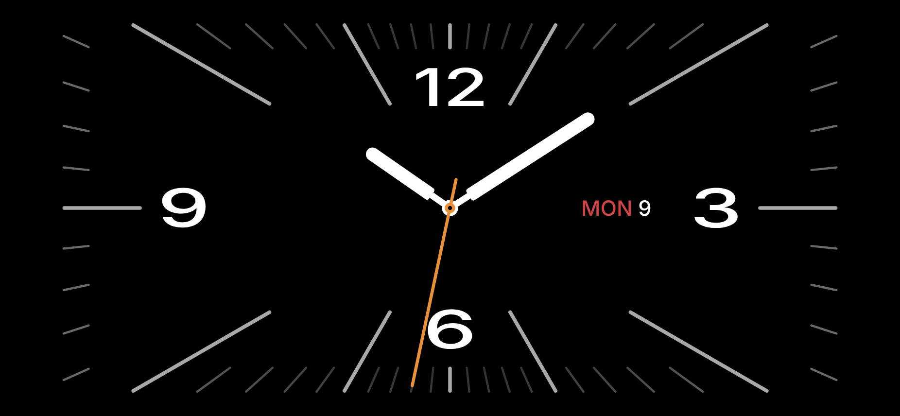
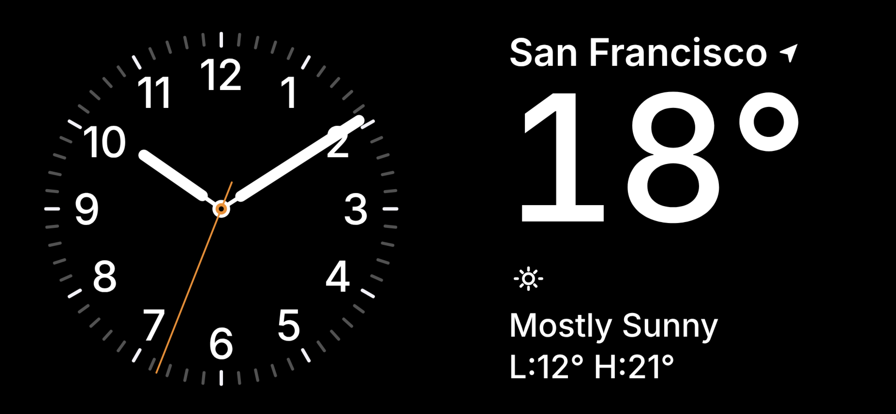
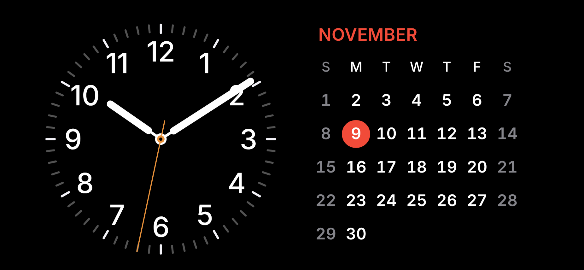
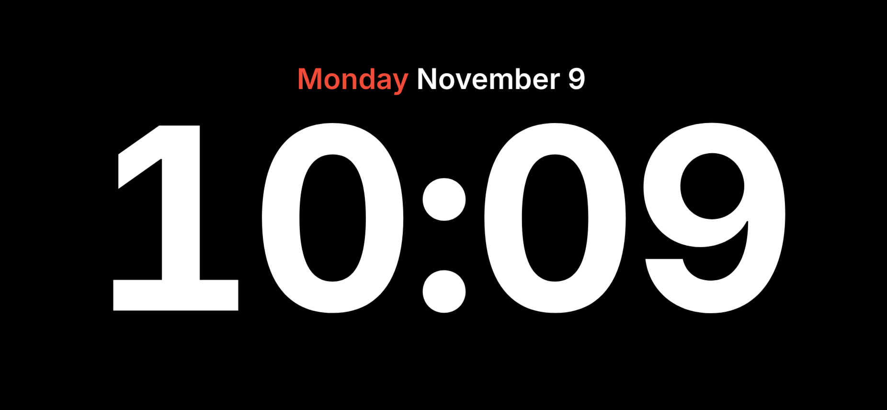
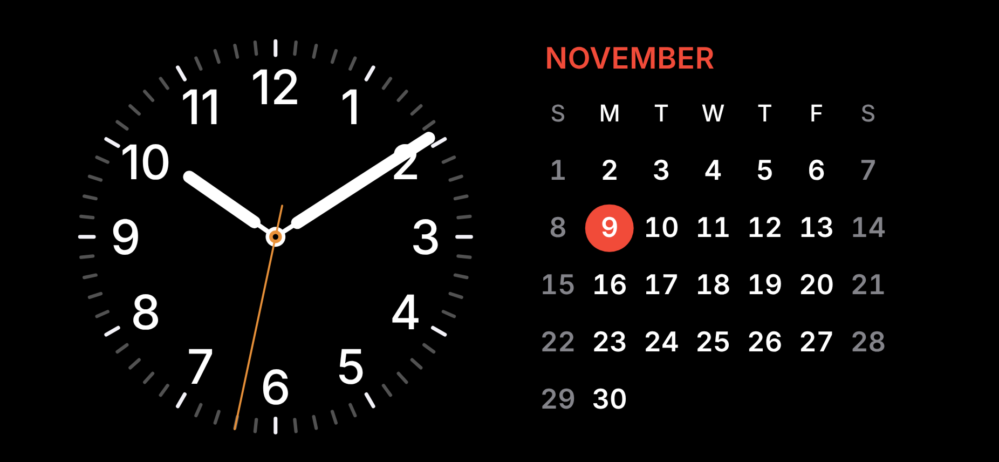
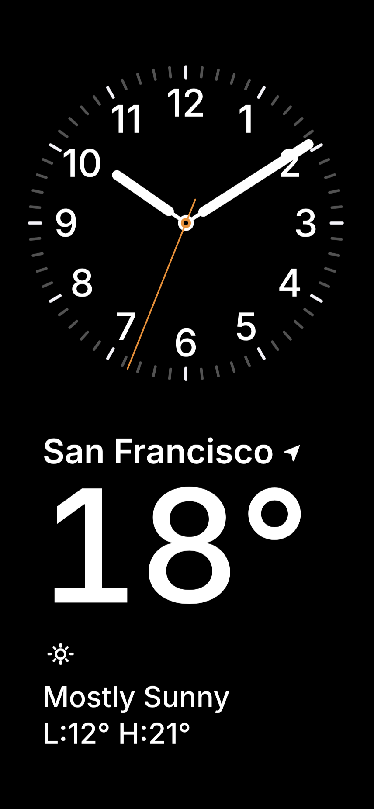

# iOS StandBy Clock: always-on, for iPhones without Always-On Display

**Live app → https://qwertycode.github.io/ios-standby-clock/**

iOS 17 added **StandBy**: a bedside-clock mode that shows while your iPhone is charging on its side. On iPhones **without an Always-On display**, StandBy only lasts about 20 seconds and then the screen goes dark. That's every iPhone except the 14 Pro / 15 Pro / 16 Pro / 17 Pro and later Pro models. To see the time again you have to tap or bump the phone.

This is a free web app that **stays on**. Put your phone on a MagSafe stand, open the clock from your Home Screen, and it keeps showing until you pick the phone up. It shifts pixels to protect the OLED screen and dims to red at night.

> If your iPhone already has Always-On (14 Pro or newer Pro), you don't need this. The built-in StandBy already stays on.

Unofficial project, not affiliated with or endorsed by Apple. The faces are original code written in the StandBy style.

| Full-screen dial | Clock + weather | Clock + calendar |
|---|---|---|
|  |  |  |

| Big digital | Night mode (auto, red) | Portrait |
|---|---|---|
|  |  |  |

---

## Features

- **Stays on.** Uses the Screen Wake Lock API, so the screen doesn't auto-lock while the clock is open.
- **Three faces.** Swipe left or right to switch:
  1. **Full-screen dial:** ticks run out to the screen edges, with big 12 / 3 / 6 / 9 numerals and the date.
  2. **Clock + widgets:** two halves you each **swipe up and down**: the clock (analog / digital) and the widgets (weather / calendar). **Double-tap** to swap which side the clock is on.
  3. **Big digital clock.**
- **Night mode.** Everything turns dim red during set hours (22:30 to 07:00 by default), or always on, or off.
- **Burn-in protection:**
  - The whole face moves a few pixels every minute, gliding so you don't notice.
  - Pure-black background.
  - The widget stack rotates every 10 minutes (adjustable).
  - Optionally rotate through the faces too.
- **Orientation setting:** follow the phone, always landscape (either direction), or always portrait. This works even with iOS rotation lock on.
- **Weather:** current location, or search for a city (suggestions as you type). Free, no account.
- **Calendar** starts the week on the day that's usual in the weather location's country (Sunday in the US, Monday in Europe, …), or pick it yourself.
- **Safe area:** in portrait the clock stays clear of the notch / Dynamic Island, the status bar and the home indicator.
- **No browser UI.** Opened from the Home Screen, it runs full-screen like a real app.

## Install on your iPhone (1 minute)

1. Open **https://qwertycode.github.io/ios-standby-clock/** in **Safari**.
2. Tap **Share** → **Add to Home Screen** → **Add**.
3. Open **StandBy Clock** from the new Home Screen icon. It runs full-screen with no address bar or toolbars.
4. Put the phone on your charger or stand. Done.

**Recommended:**
- **Settings → Display & Brightness → Auto-Lock → Never.** A backup in case iOS ignores the wake lock. Older iOS versions don't support the wake lock at all.
- **Lower your brightness** manually. A web app can't change screen brightness, and dim plus black is what really saves an OLED.
- Optional: **Guided Access** (Settings → Accessibility) locks the phone to the clock so a stray touch can't leave it.

**Using it:**
- **Swipe left / right** to change faces.
- On the clock + widgets face, **swipe up / down** over the clock (analog ↔ digital) or over the widgets (weather ↔ calendar). **Double-tap** it to move the clock to the other side.
- **Tap** to show the ⚙︎ settings button.

## Settings

| Setting | What it does |
|---|---|
| Orientation | *Follow phone*, *Always landscape ↻ / ↺* (the clock draws itself rotated, so it works with rotation lock on), or *Always portrait*. |
| 24-hour digital time | 24h or 12h on the digital clocks. |
| Second hand / Smooth sweep | Show the orange second hand; sweep smoothly or tick. |
| Day / Night brightness | Extra dimming on top of the phone's brightness. |
| Night mode, starts, ends | Auto (by schedule), always on, or off. |
| Weather location / Units | Search for a city and pick it from the suggestions, or tap *📍 My location*. °C or °F. |
| Week starts | *Auto* (from the weather location's country), Sunday, Monday or Saturday. |
| Rotate widgets / faces | Minutes between automatic changes (0 = off). Helps against burn-in. |
| Pixel shift every / range | How often and how far the face moves. |

## Things to know

- **Settings are remembered.** They're saved on the phone and survive closing the app and restarting the phone. The Home Screen app and a Safari tab keep separate settings. Deleting the Home Screen icon deletes its settings.
- **No location prompt?** iOS only asks if *Settings → Privacy & Security → Location Services → Safari Websites* is set to *Ask Next Time* or *While Using the App*. If it's *Never*, the request fails silently. Change it, then tap *📍 My location* in the clock's settings. Or just search for your city.

- **Status bar in portrait:** in portrait, iOS always shows its own time and battery at the top of a Home Screen app. Web apps can't hide it. In landscape it's hidden.
- **Battery health:** a phone sitting at 100% on a warm MagSafe charger all day ages its battery faster. Keep *Optimized Battery Charging* on. iPhone 15 and newer can also set an 80% limit.
- **Burn-in:** pixel shift and dimming lower the risk but don't remove it. Night mode for long stretches and widget rotation help most.
- **Opening it in a Safari tab** shows the browser bars. That's why the page suggests *Add to Home Screen*.

## Privacy

There's no server, account, analytics or tracking. This is a static page on GitHub Pages.

- Settings are stored only on your phone, in `localStorage`.
- For weather, your phone talks directly to [Open-Meteo](https://open-meteo.com/) (the forecast and city search) and, with location on, [BigDataCloud](https://www.bigdatacloud.com/) (your town's name). Coordinates go only to those services.

## For developers

Everything is in one file, [`index.html`](index.html): HTML, CSS and JS with no build step and no dependencies.

```
index.html             the app
manifest.webmanifest   Home Screen app metadata (standalone, black)
icons/                 app icons
docs/screenshots/      README images
```

**Run locally:**

```bash
python3 -m http.server 8000
```

Then open http://localhost:8000.

**Keyboard (desktop browser):**

| Key | Action |
|---|---|
| ← / → (or H / L) | Previous / next face |
| 1, 2, 3 | Jump to a face |
| ↑ / ↓ (or K / J) | Previous / next widget on the split face |
| Shift + ↑ / ↓ | Switch the split face's clock between analog and digital |
| Shift + ← / → | Move the split face's clock to the left / right (top / bottom in portrait) |
| S or , | Open / close settings |
| F | Full screen on / off |
| Esc | Close settings or the hint |

**Add a face:**
1. Add a `<section class="face" id="fX">…</section>` inside `#stage`. Faces are switched in document order.
2. Draw it in the existing update functions:
   - `drawHands()` handles analog hands: use `handSVG()` / `secondSVG()` and rotate with the SVG `transform` attribute, not CSS. CSS transform-origin is unreliable on SVG in iOS Safari.
   - `updateText()` handles text that changes each second or each day.
3. Size things with `var(--vh)` / `var(--vw)` (1% of the clock area), not real `vh` / `vw`. The clock area can be rotated relative to the screen.
4. Use the colour variables (`--white`, `--red`, `--second`, …) so night mode recolours it for free.
5. If it needs a portrait layout, add rules under `body.portrait`.

**Add a widget:** add `<div class="pv"><div class="wbox …"></div></div>` inside `#trackB` and size its contents with `var(--wu)`. A widget is an 80 × 100 `--wu` box, scaled to fit and centred in its half of the screen. Clock views go in `#trackC` and use `var(--cu)`.

Pushing to `main` redeploys GitHub Pages in about a minute. Phones pick up the new version the next time the app is opened.

## License

[MIT](LICENSE)
